# AI Test Management Hub

[](https://github.com/fathirwafda/ai-test-management-hub/actions/workflows/ci.yml)


A lightweight, self-hosted test management tool in the spirit of TestRail and Xray, with AI assistance where it
saves a tester time and a human review step everywhere it could do harm.

You keep **test cases** in suites, run them in **test runs** against an environment and build, record results with
**evidence** (screenshots, video, logs, HAR files), and **import automated results** from JUnit XML or Playwright JSON so
manual and automated testing land in the same place. A **dashboard** shows coverage, pass-rate trend and flaky
candidates. Three **AI features** draft test cases from a user story, suggest the likely cause of a failure, and draft a
release-readiness summary. They run on a deterministic offline mock by default and on Claude when an API key is set,
and nothing they produce is saved until a person accepts it.

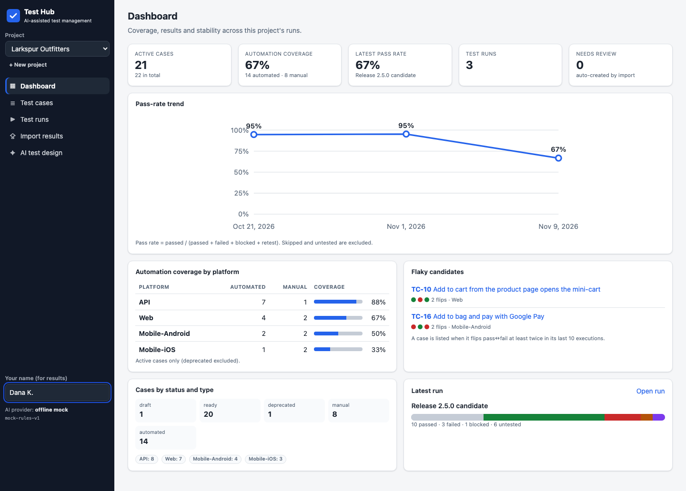

## Contents

- [Features](#features)
- [Screenshots](#screenshots)
- [Architecture](#architecture)
- [Quick start](#quick-start)
- [Configuration](#configuration)
- [Importing automated results](#importing-automated-results)
- [API overview](#api-overview)
- [How AI is used, and its limits](#how-ai-is-used-and-its-limits)
- [Testing this project](#testing-this-project)
- [Project structure](#project-structure)
- [Design decisions](#design-decisions)
- [Roadmap](#roadmap)
- [License](#license)

## Features

**Test design**

- Projects → suites → test cases with a project-wide key (`TC-12`), title, description, preconditions, ordered steps
  (action + expected result), priority, tags, linked requirement or story, and status (draft, ready, deprecated).
- Platform per case: `API`, `Web`, `Mobile-Android`, `Mobile-iOS`; type `manual` or `automated`, with an automation
  reference (`classname#method` for JUnit, `file#Describe > title` for Playwright) used to map imported results.
- Filters by suite, platform, type, status, tag and free text (title, key or automation reference).
- Cases that already have results cannot be deleted, only deprecated, so history stays intact.

**Execution**

- Create a run from a filter (platform, type, tag, suite, ready/draft) or from explicit case ids, with environment and
  build. Deprecated cases are never included.
- Per result: status (untested, passed, failed, blocked, skipped, retest), comment, duration, executed by, timestamp.
- Evidence attachments of any type, stored on local disk. Images and video preview inline, text files (logs, JSON,
  HAR, XML) preview as text, everything else downloads. SVG and HTML are always served as downloads.
- Progress bar, pass rate and per-status counts; closed runs are read-only until reopened.
- Export a run as Markdown, HTML or CSV (CSV cells are protected against spreadsheet formula injection).

**Automated results**

- Upload JUnit XML (Maven Surefire/Failsafe, TestNG, REST Assured, Selenium, Appium, pytest, Jest via jest-junit) or
  Playwright JSON reporter output, into a new run or an open one.
- Mapping: a case key in the test title (`[TC-12]`) wins, then the normalized automation reference. Results that match
  nothing create **draft cases flagged "needs review"**, so nothing is silently dropped.
- Failure messages, stack traces and `system-out`/`system-err` are stored on the result; Playwright attachment paths
  (screenshots, traces, videos) are recorded as evidence metadata. Flaky tests (passed on retry) are recorded as
  passed with a note.
- A `curl` script and a GitHub Actions snippet post results from CI.

**Dashboard**

- Totals by platform, type and status; automation coverage per platform; pass-rate trend over the last 10 runs;
  flaky candidates (cases that flip between passed and failed at least twice in their last 10 executions); latest
  run at a glance.

**AI assistance (human in the loop)**

1. **Test case generation** from a user story or acceptance criteria: Given/When/Then steps, platform, priority and a
   suggested manual/automated type, shown as editable drafts. You choose which to save; they are saved as `draft`.
2. **Failure triage**: classifies a failed, blocked or retest result as product bug, test issue, environment or
   test data, with the signals it relied on, a confidence level and next steps. Saved to the result only when a
   tester accepts it, and always shown as "AI-suggested, accepted by …".
3. **Run summary**: a short release-readiness verdict with highlights and risks that you can edit and save as run notes.

## Screenshots

|                                                                                             |                                                                                                 |
| ------------------------------------------------------------------------------------------- | ----------------------------------------------------------------------------------------------- |
| 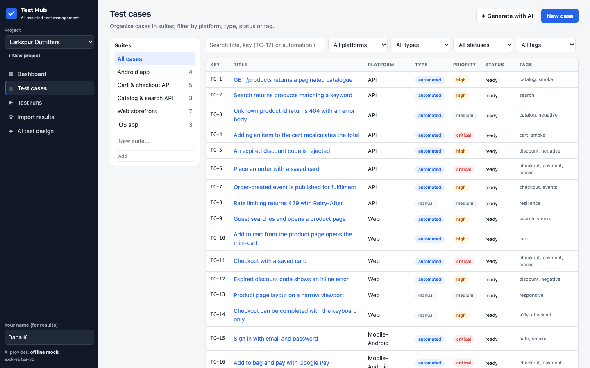 Test cases with suites and filters           | 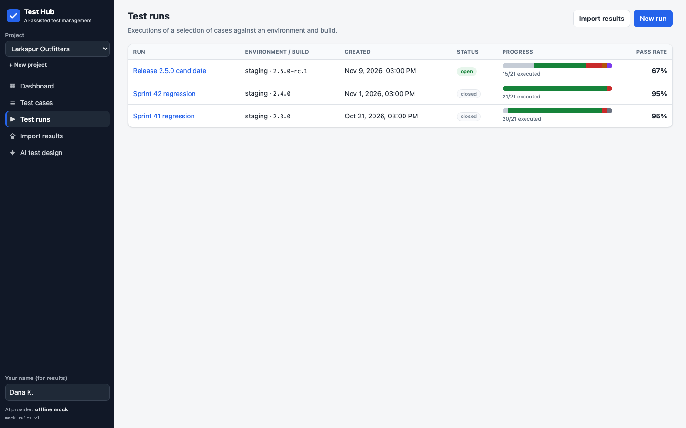 Runs with progress and pass rate                   |
| 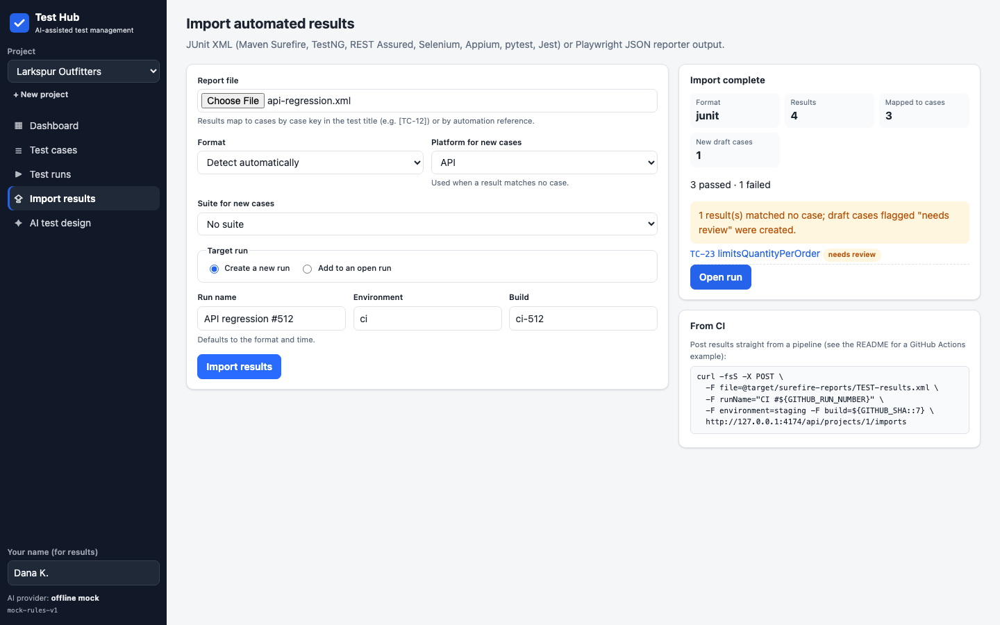 JUnit import with an auto-created draft case | 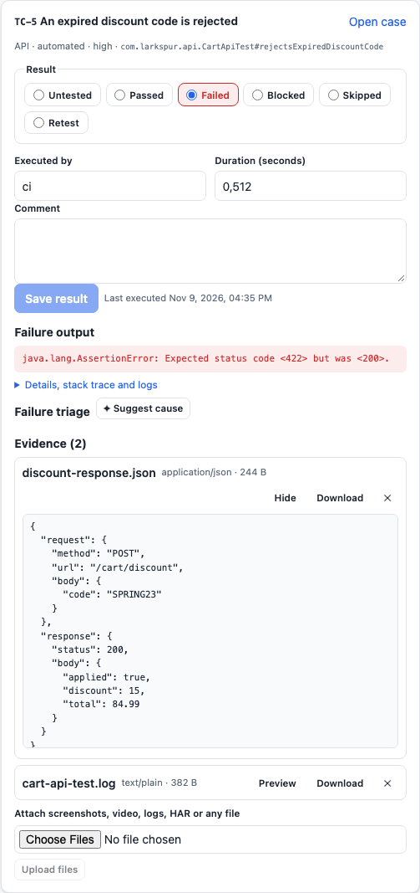 Failed API result with JSON evidence preview |

Run detail with an image evidence preview, an AI triage suggestion and an AI release summary:

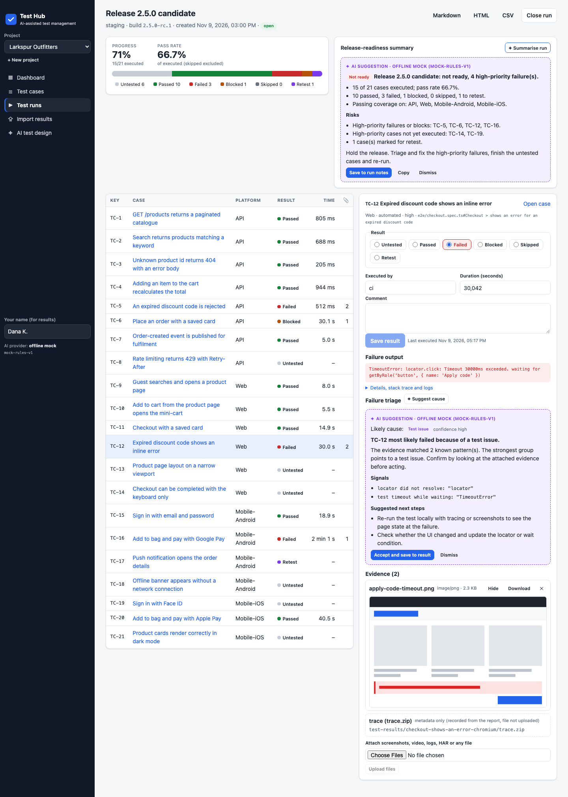

AI test design: drafts from a user story, editable before saving:

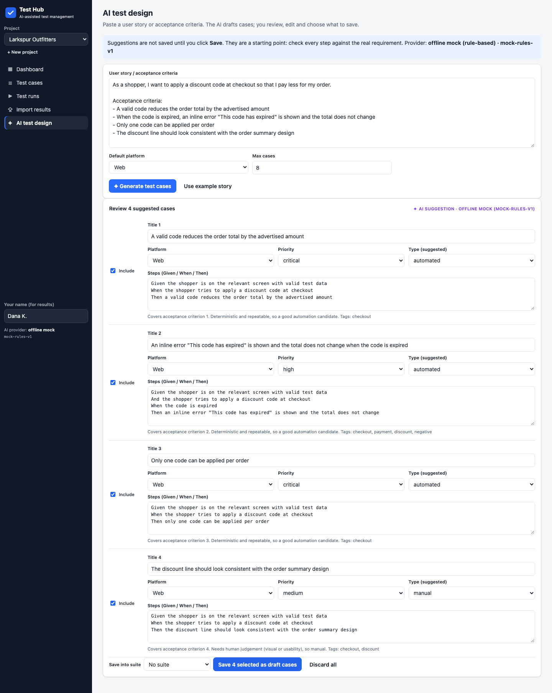

Screenshots are captured from the seeded demo by `npm run screenshots` (Playwright). The demo shop, people and data
are fictional.

## Architecture

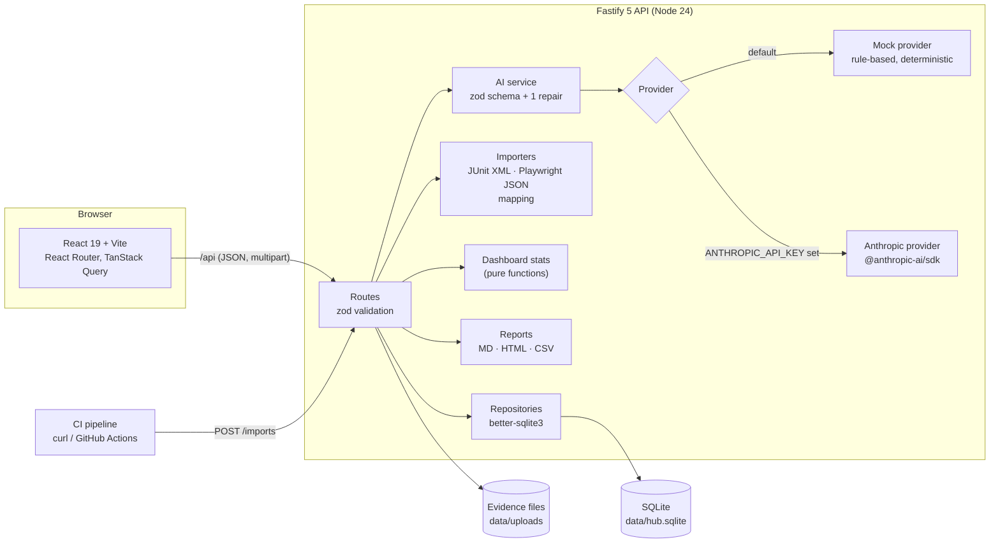

In production mode the API also serves the built web app, so one Node process is the whole application. In
development, Vite serves the UI and proxies `/api` to the API. Domain types and zod schemas live in
`packages/shared` and are used by both sides.

### Data model

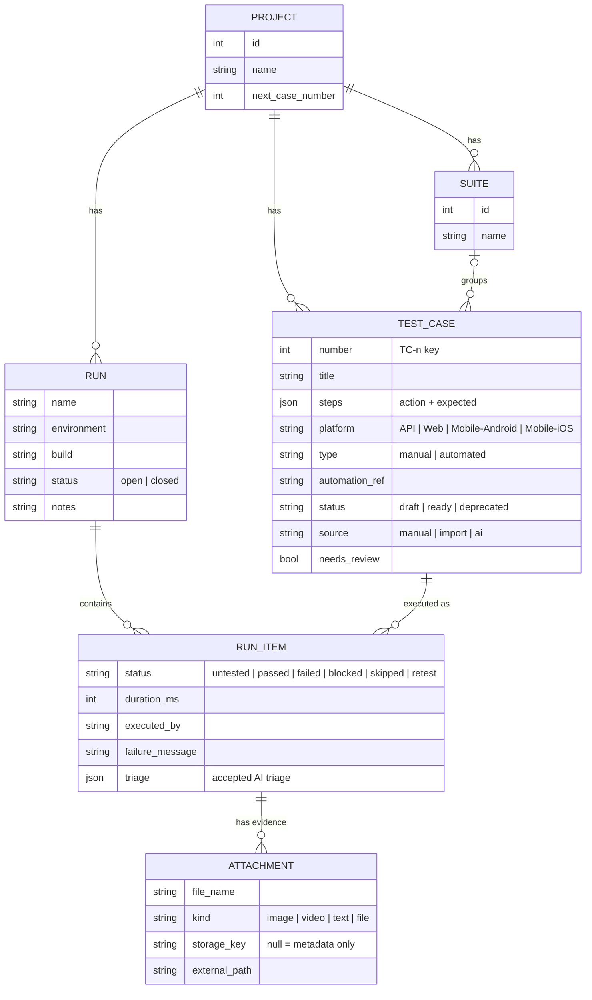

### From CI to the dashboard

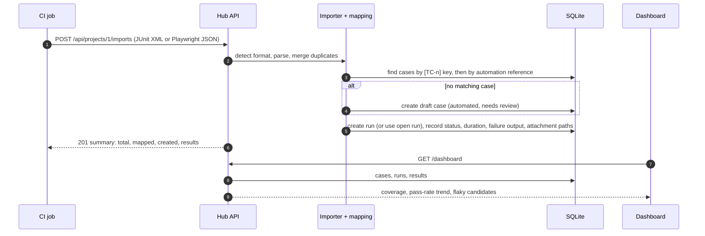

### AI assistance with human review

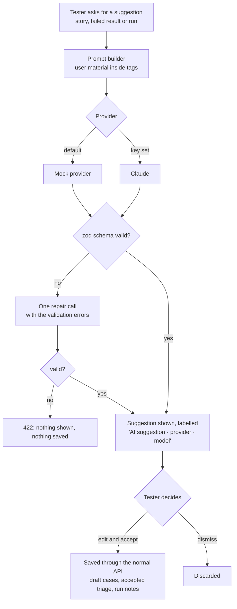

## Quick start

Requirements: Node 24 (see `.nvmrc`; Node 22.12+ also works) and npm.

```bash
npm install          # also builds packages/shared
npm run seed         # demo project: 22 cases, 3 historical runs, generated evidence
npm run dev          # API on :4000 (tsx watch) + web on http://localhost:5173 (Vite)
```

Production-style, one process serving API and UI:

```bash
npm run build
npm start            # http://localhost:4000
```

No API key is needed: the AI features use the offline mock provider until `ANTHROPIC_API_KEY` is set.

## Configuration

Set these as environment variables (export them, or use your process manager). There is no `.env` file in the
repository on purpose.

| Variable            | Default                                  | Description                                                                                |
| ------------------- | ---------------------------------------- | ------------------------------------------------------------------------------------------ |
| `PORT`              | `4000`                                   | API port (also serves the built UI).                                                       |
| `HOST`              | `127.0.0.1`                              | Bind address. Use `0.0.0.0` in a container.                                                |
| `DATA_DIR`          | `./data`                                 | Base directory for the database and uploads (relative to the repository root).             |
| `DB_FILE`           | `$DATA_DIR/hub.sqlite`                   | SQLite file.                                                                               |
| `UPLOAD_DIR`        | `$DATA_DIR/uploads`                      | Where evidence files are stored.                                                           |
| `MAX_UPLOAD_MB`     | `25`                                     | Per-file upload limit (evidence and reports).                                              |
| `SERVE_WEB`         | `true`                                   | Set to `false` to run the API without serving `apps/web/dist`.                             |
| `WEB_DIST`          | `apps/web/dist`                          | Location of the built UI.                                                                  |
| `LLM_PROVIDER`      | `mock`, or `anthropic` when a key is set | Force `mock` or `anthropic`.                                                               |
| `ANTHROPIC_API_KEY` | unset                                    | Enables Claude. Keep it in your secret store, never in the repository.                     |
| `LLM_MODEL`         | `claude-sonnet-5-5`                      | `claude-sonnet-5-5`, `claude-opus-5-5` or `claude-haiku-5-5`. The UI can pick per request. |
| `LOG_LEVEL`         | `info`                                   | Fastify/pino log level.                                                                    |

## Importing automated results

`POST /api/projects/:projectId/imports` takes `multipart/form-data`:

| Field        | Required | Meaning                                                                                              |
| ------------ | -------- | ---------------------------------------------------------------------------------------------------- |
| `file`       | yes      | JUnit XML or Playwright JSON report                                                                  |
| `format`     | no       | `auto` (default), `junit` or `playwright`                                                            |
| `runId`      | no       | Add results to this open run. Otherwise a new run is created from `runName`, `environment`, `build`. |
| `platform`   | no       | Platform for cases created from unmatched results (default `API`)                                    |
| `suiteId`    | no       | Suite for created cases                                                                              |
| `executedBy` | no       | Recorded on each result (default `ci`)                                                               |

How a result finds its case:

1. A case key anywhere in the test title or reference, e.g. `test("pays with a saved card [TC-11]")`.
2. Otherwise the automation reference, compared after normalization (case, whitespace, `›`/`>` and `::`/`#`
   variants, path separators). JUnit produces `classname#name`; Playwright produces `file#Describe > title`.
3. Otherwise a draft case is created and flagged **needs review**, so the import never loses a result.

### Playwright

```bash
PLAYWRIGHT_JSON_OUTPUT_NAME=results.json npx playwright test --reporter=json,list
curl -fsS -F file=@results.json -F platform=Web -F runName="Web e2e" http://localhost:4000/api/projects/1/imports
```

When a spec runs in several projects (browsers, devices), the worst outcome wins and each project's outcome goes into
the comment. Attachment paths (screenshots, traces, videos) are stored as metadata; the files stay with your CI
artifacts.

### Java: Maven Surefire with REST Assured, Selenium or Appium

```bash
mvn -B test        # writes target/surefire-reports/TEST-*.xml
for f in target/surefire-reports/TEST-*.xml; do
  HUB_RUN_ID=42 scripts/publish-results.sh "$f"
done
```

Set the case's automation reference to `com.example.CartApiTest#addsItem` (class name and method), or put the key
in the display name (`@DisplayName("adds item [TC-4]")`). Appium suites run through TestNG or JUnit produce the same
format; set `-F platform=Mobile-Android` (or `Mobile-iOS`) for created cases.

### pytest and Jest

```bash
pytest --junitxml=reports/junit.xml        # reference: tests.api.test_cart#test_adds_item
npx jest --reporters=default --reporters=jest-junit   # writes junit.xml
```

### From CI

- [`scripts/publish-results.sh`](scripts/publish-results.sh): a small `curl` wrapper (`HUB_URL`, `HUB_PROJECT_ID`,
  `HUB_RUN_ID`, `HUB_PLATFORM`).
- [`docs/examples/publish-results.github-actions.yml`](docs/examples/publish-results.github-actions.yml): a GitHub
  Actions step that posts results after the tests, even when they fail.

## API overview

JSON over HTTP, validated with zod; errors are `{ "error": "...", "details": [...] }` with 400, 404, 409, 413 or 422.
The OpenAPI 3.1 document is served at `GET /api/openapi.json` (request bodies are generated from the same zod schemas
the handlers use).

| Area                  | Endpoints                                                                                                                                                                                                                                                               |
| --------------------- | ----------------------------------------------------------------------------------------------------------------------------------------------------------------------------------------------------------------------------------------------------------------------- |
| Projects and suites   | `GET/POST /api/projects`, `GET/PATCH /api/projects/:id`, `GET/POST /api/projects/:id/suites`, `PATCH/DELETE /api/suites/:id`                                                                                                                                            |
| Test cases            | `GET/POST /api/projects/:id/cases` (filters: `suiteId`, `platforms`, `types`, `statuses`, `priorities`, `tags`, `q`, `needsReview`), `POST /api/projects/:id/cases/bulk`, `GET/PATCH/DELETE /api/cases/:id`, `GET /api/cases/:id/history`, `GET /api/projects/:id/tags` |
| Runs                  | `GET/POST /api/projects/:id/runs`, `GET/PATCH/DELETE /api/runs/:id`, `POST /api/runs/:id/close`, `POST /api/runs/:id/reopen`, `GET /api/runs/:id/report?format=md\|html\|csv`                                                                                           |
| Results and evidence  | `PATCH /api/run-items/:id`, `POST /api/run-items/:id/attachments` (multipart, `files`), `GET /api/attachments/:id/content[?download=1]`, `DELETE /api/attachments/:id`                                                                                                  |
| Import                | `POST /api/projects/:id/imports` (multipart)                                                                                                                                                                                                                            |
| Dashboard             | `GET /api/projects/:id/dashboard`                                                                                                                                                                                                                                       |
| AI (suggestions only) | `GET /api/ai/status`, `POST /api/ai/generate-cases`, `POST /api/run-items/:id/triage`, `POST /api/runs/:id/summary`                                                                                                                                                     |

## How AI is used, and its limits

**Where it runs.** `apps/api/src/ai`. One provider interface with two implementations:

- `MockProvider` (default): deterministic rules. It splits acceptance criteria (bullets, numbered items or Gherkin
  scenarios) into cases, matches failure text against keyword groups (network errors, locator timeouts, data
  conflicts, assertion output) and adds up run numbers. It exists so the app, the tests and CI work offline with no
  key, and so a test failure always means the code changed. It is not a model and does not understand meaning.
- `AnthropicProvider`: Claude through `@anthropic-ai/sdk`, default `claude-sonnet-5-5` (`claude-opus-5-5` and
  `claude-haiku-5-5` can be chosen). It uses low effort for these short structured answers and, on Sonnet and Opus,
  the server-side refusal fallback.

**Guard rails.**

- Every answer is parsed and validated against a zod schema (`packages/shared/src/ai.ts`). If it does not validate,
  the model gets exactly one repair turn with the validation errors; a second failure returns 422 and nothing is shown.
- AI endpoints never write to the database. Saving goes through the normal endpoints after a person clicks Save or
  Accept, and saved items keep their origin: cases get `source: ai` and status `draft`; accepted triage is stored with
  the name of the person who accepted it.
- Every suggestion in the UI is labelled with the provider and model.
- User material (stories, logs, failure output) is placed inside tags in the prompt and described as material to
  analyse. That reduces, but does not remove, the chance that text inside a log steers the model; the human review
  step is the real control.

**Limits to keep in mind.**

- Generated cases are a first draft. They can miss edge cases, misread a criterion or invent detail; review every step
  against the real requirement before setting a case to ready.
- Triage sees only the failure message, stack trace, up to three text evidence files and the case's earlier results.
  It cannot open screenshots or traces, and it will be confidently wrong sometimes. Treat the category as a hint for
  where to look first.
- The run summary only restates numbers and statuses the hub already has; it knows nothing about open bugs, risk
  appetite or what changed in the release.
- With Claude enabled, story text, failure output and log excerpts are sent to the Anthropic API. Do not enable it for
  data you are not allowed to send to a third-party service.
- No numbers in this README measure AI quality. The tests check the contract (schemas, repair, labelling, no
  auto-save), not how good the suggestions are.

## Testing this project

| Layer | Tool                                                                                     | What it covers                                                                                                                                                                                                                                                                                                                                |
| ----- | ---------------------------------------------------------------------------------------- | --------------------------------------------------------------------------------------------------------------------------------------------------------------------------------------------------------------------------------------------------------------------------------------------------------------------------------------------- |
| Unit  | Vitest                                                                                   | JUnit parsing (Surefire/REST Assured, pytest, Jest, TestNG/Appium fixtures, DOCTYPE rejection), Playwright JSON parsing (projects, flaky, skipped, ANSI, attachments), mapping and normalization, dashboard stats and flaky detection, AI output validation and repair, mock provider, Anthropic provider with a fake client, report escaping |
| API   | Vitest + `fetch` against the real Fastify app on a random port with a temporary database | CRUD and validation, run lifecycle (close/reopen, read-only), evidence upload, preview headers and size limits, imports (mapping, auto-created cases, existing/closed runs, bad input is atomic), AI endpoints, OpenAPI                                                                                                                       |
| E2E   | Playwright against the built app with a freshly seeded database and the mock provider    | Create a case; start a run, record pass/fail with evidence upload and previews, close it; AI triage accept; AI run summary; CSV export; JUnit import and dashboard update; AI generation, edit and save                                                                                                                                       |

```bash
npm run lint && npm run format:check && npm run typecheck
npm test                 # unit + API
npm run build && npm run test:e2e
npm run check            # all of the above
```

CI (`.github/workflows/ci.yml`) runs lint, format check, typecheck, unit and API tests and the build, then the
Playwright suite against the built app with the mock provider, and uploads the Playwright report. It never calls the
real Anthropic API.

## Project structure

```
apps/
  api/            Fastify API: routes, repositories (SQLite), importers, AI, stats, reports, seed
    src/ai/       provider interface, mock, Anthropic, prompts, validation + repair
    src/importers JUnit XML, Playwright JSON, mapping, import service
    test/         unit/, api/, fixtures/ (sample reports)
  web/            React app: pages, components, API hooks, styles
packages/
  shared/         zod schemas and types used by both apps
e2e/              Playwright specs and fixtures
scripts/          publish-results.sh, screenshot capture
docs/             screenshots, CI example
```

## Design decisions

- **SQLite and local files.** A test management tool for one team does not need a database server. `better-sqlite3`
  is synchronous, fast and transactional, which keeps imports all-or-nothing. Migrations are forward-only SQL in
  `apps/api/src/db/migrations.ts`.
- **Shared zod schemas.** The API validates with the same schemas the web app imports for types, and the OpenAPI
  request bodies are generated from them.
- **Imports never drop results.** Unmatched results become flagged drafts instead of errors, because a silent gap in a
  run is worse than a case someone has to tidy up.
- **Metadata-only evidence for Playwright attachments.** Report paths point at files on the CI machine; uploading them
  would need a second step. The path is kept so the reviewer knows where to look.
- **Deterministic mock first.** The AI features are designed against a contract that the mock and Claude both satisfy,
  so the whole product can be developed and tested offline.

## Roadmap

- Authentication and roles (today there is none: run it locally or behind your own auth proxy).
- Upload Playwright attachments and JUnit `[[ATTACHMENT|path]]` files together with the report.
- Structured outputs for the Claude provider, and an offline eval set for the triage and generation prompts.
- Requirements as first-class entities with coverage per requirement; Jira/Xray links.
- Test case versioning and a change history per case.
- Shared steps and parameterised cases.
- Postgres option for multi-instance deployments.

## License

[MIT](LICENSE) © Fathir Wafda
